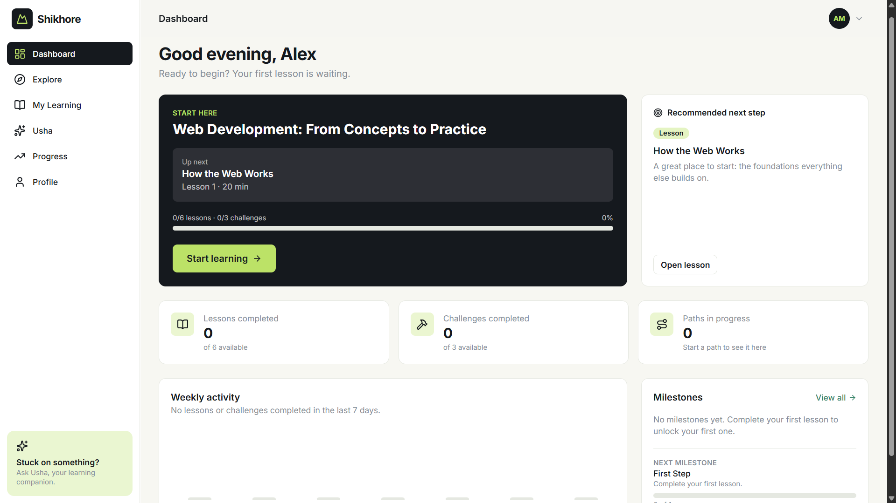
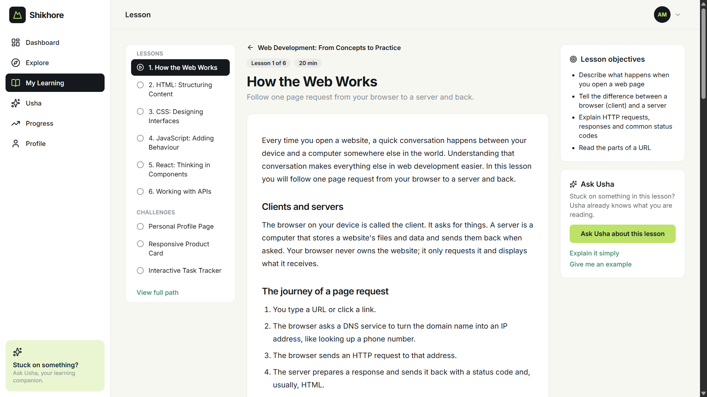
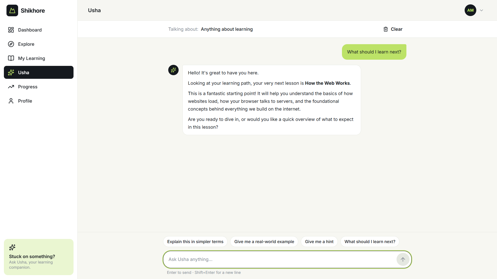

# Shikhore

**Learn with purpose. Rise through practice.** (শিখরে উঠতে, শিখো রে!)

Shikhore is a practical learning platform that helps people turn knowledge into real-world skills through a guided learning path, hands-on challenges and a personal AI companion named **Usha**.

- **Live demo:** https://shikhore-umber.vercel.app
- **Repository:** https://github.com/iamtawhidkhan-ui/shikhore
- **Built for:** Credosis Phase 02, Frontend Engineer Intern

## Demo credentials

| Email | Password |
| --- | --- |
| `demo@shikhore.app` | `Shikhore@2026` |

The same credentials are shown on the login page. Sign-in is for demonstration only (see [Known limitations](#known-limitations)).

## The problem

People can understand a concept in theory and still struggle to use it to solve a practical problem. Most learning products stop at explanation; learners rarely get a structured chance to apply what they know, or help when they get stuck.

## The solution

Shikhore connects three stages in one journey:

1. **Learn:** structured lessons with clear explanations and real-world examples.
2. **Apply:** practical challenges based on realistic tasks.
3. **Improve:** contextual guidance from Usha, plus visible progress and milestones.

A learner can sign in, choose a path, study a lesson, answer a knowledge check, submit a practical challenge, ask Usha for help and watch their progress update.

## Screenshots

| Dashboard | Lesson |
| --- | --- |
|  |  |

| Challenge | Usha |
| --- | --- |
|  |  |

## Main features

- **Demo login** with inline validation and protected routes (signed-out visitors are sent to `/login`).
- **Dashboard** where every number is derived from saved learner state: continue-learning card, recommended next step, lessons / challenges / paths overview, a 7-day activity chart built from real completion dates, and a milestone preview.
- **Explore** with working search and difficulty / category filters. One path is fully available; others are previews marked *Coming soon*.
- **Learning path** page with outcomes, overall progress, and a curriculum showing completed, up-next and not-started items, plus the final project brief.
- **Lesson viewer** with curriculum navigation, previous / next, objectives and a knowledge check that explains why each answer is right or wrong. Completing a lesson never inflates progress.
- **Challenge workspace** with instructions, progressive hints, a written-answer editor, saved attempt history, feedback and a completion action. Empty submissions are rejected.
- **Usha, the AI companion**, powered by Google Gemini through a secure server-side endpoint, with lesson and challenge context.
- **Progress and achievements** unlocked from real activity (for example, the multi-day achievement needs three different calendar days).
- **Profile** with a completion summary, sign out, and a confirmed *Reset progress* action.
- **Persistence:** progress survives refreshes and browser restarts. Corrupt saved data recovers to a fresh state instead of crashing.
- **Responsive layout:** fixed sidebar on desktop, drawer on tablet, bottom navigation on phones.

### The learning path

**Web Development: From Concepts to Practice** has 6 lessons (How the Web Works, HTML, CSS, JavaScript, React, Working with APIs), 3 written challenges (Personal Profile Page, Responsive Product Card, Interactive Task Tracker) and a final mini-project brief (Personal Learning Dashboard).

Progress uses one formula everywhere: `overall = round(lessonProgress × 0.7 + challengeProgress × 0.3)`.

## Tech stack

| Area | Choice |
| --- | --- |
| Frontend | React, Vite, TypeScript (strict) |
| Styling | Tailwind CSS v4 |
| Routing | React Router |
| Icons | Lucide React |
| State | React Context and custom hooks |
| Persistence | `localStorage` (demo only) |
| AI | Google Gemini API via `@google/genai` |
| Server | Vercel serverless function (`api/assistant.ts`) |
| Hosting | Vercel |

## Run it locally

Requirements: Node.js 20 or newer.

```bash
git clone https://github.com/iamtawhidkhan-ui/shikhore.git
cd shikhore
npm install
cp .env.example .env     # on Windows PowerShell: Copy-Item .env.example .env
npm run dev
```

Open http://localhost:5173 and sign in with the demo credentials. The app works without a Gemini key; only Usha needs one.

### Environment variables

Create a `.env` file (it is git-ignored) and add:

```
GEMINI_API_KEY=your_private_api_key
GEMINI_MODEL=gemini-3.5-flash-lite
```

- Get a key from [Google AI Studio](https://aistudio.google.com/).
- `GEMINI_MODEL` is read at runtime, so the model can be changed without touching code. Model availability, quotas and pricing change over time, so check Google's current model list before deploying. The live demo uses `gemini-3.5-flash-lite`.
- These are **server-side secrets**. They never use a `VITE_` prefix and are never sent to the browser. Restart `npm run dev` after editing `.env`.
- `npm run dev` serves `/api/assistant` locally using the same code that runs on Vercel, so you do not need the Vercel CLI.

### Deploying to Vercel

Import the repository, add `GEMINI_API_KEY` and `GEMINI_MODEL` under *Environment Variables*, and deploy. The repository includes a `.npmrc` (`legacy-peer-deps=true`) so installs succeed even though the linter packages have not yet declared support for the newest TypeScript.

### Useful commands

```bash
npm run build                    # production build
npx tsc -b                       # type-check the app
npx tsc -p tsconfig.api.json     # type-check the serverless function
```

### Testing the multi-day achievement

The *Consistent Learner* milestone needs activity on three different days. In development only, you can fake the date in the browser console:

```js
localStorage.setItem("shikhore-dev-date", "2026-11-07")   // complete something, then try another date
localStorage.removeItem("shikhore-dev-date")              // go back to the real date
```

This override is ignored in production builds.

## How Usha works

```
Usha chat UI  →  src/services/aiService.ts  →  POST /api/assistant  →  Gemini API
```

1. **Context.** The browser sends the question plus the context of where the learner is: the current lesson text, or the challenge details and the learner's latest answer, plus a short factual summary of their real progress.
2. **Server.** `api/assistant.ts` validates the request (types, length, size), keeps only the last 10 messages of history, applies a timeout and basic rate limiting, builds the tutor prompt, and calls Gemini with the key from `GEMINI_API_KEY`.
3. **Tutor behaviour.** Usha's instructions ask her to explain simply, give hints before solutions, explain mistakes kindly, avoid inventing lesson content, and never claim a learner completed something unless the app states it. Lesson and learner text is passed as reference data, not as instructions.
4. **Errors.** Quota, provider and network failures become friendly messages with a *Try again* button. A failed request never removes earlier messages, and the API key is redacted from logs and never returned.
5. **Challenge feedback.** When Usha reviews an attempt, her feedback is saved with that attempt so it appears in the challenge workspace.

## Project structure

```
api/assistant.ts        Serverless function for Usha (Gemini)
src/
  components/           common, layout, dashboard, learning, challenges, assistant
  pages/                one component per route
  data/                 learning path, lessons, challenges, achievements, demo user
  context/              AuthContext and ProgressContext
  hooks/                useAuth, useProgress, useAssistant, useDashboardData
  services/             aiService (calls /api/assistant)
  types/                shared TypeScript contracts
  utils/                storage, progress, achievements, dates, context builders
```

Business logic (progress formula, achievement rules, storage validation) lives in pure utility functions, not in page components.

## Known limitations

- **Authentication is a demo.** One fixed account and no registration, password recovery or database. This is intentional for this version.
- **Progress is stored in the browser** (`localStorage`), so it is per browser and per device.
- **Challenges are written responses.** There is no in-browser code execution and no automatic grading; Usha gives guidance, not an official grade. The final project is a guided brief.
- **Only one learning path is fully built.** The other paths are previews.
- **Usha depends on the Gemini API.** Free-tier quotas can run out, and the basic rate limit is held in memory per serverless instance, so it is a best-effort safeguard rather than a strict one.
- **The Usha conversation** is kept for the browser session only and is not synced between devices.
- **No automated test suite is included yet.**

## Future improvements

- Real authentication and a database so progress follows the learner across devices.
- More learning paths and richer lesson formats.
- A sandboxed code runner so challenges can be checked automatically.
- Streaming answers from Usha, and per-learner usage limits.
- Instructor or peer review alongside AI feedback.
- Automated unit and end-to-end tests, and subtle motion polish.
- Bengali language support for lessons and Usha.
